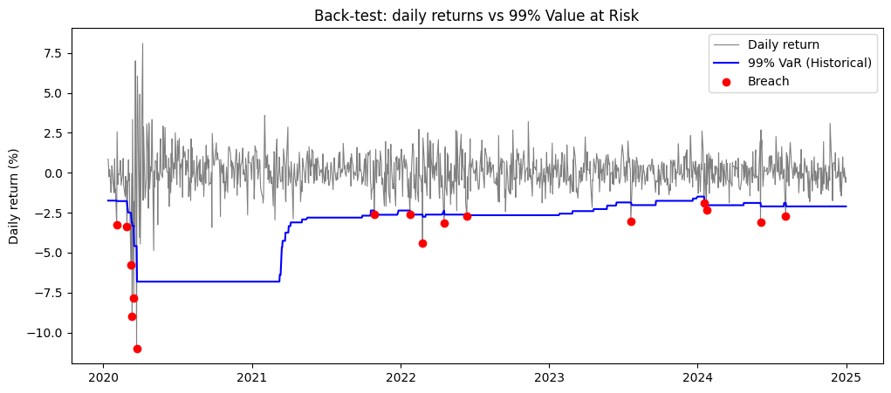

# Market Risk Check: VaR, Back-Testing & Stress Testing

**How much could a ₹10 lakh stock portfolio lose on a bad day, and was that estimate right in the past?**

This project calculates the daily risk of a 5-stock Nifty portfolio, checks the model against real outcomes using the Basel back-testing rules banks report to regulators, turns the result into a regulatory capital figure, and stress-tests it on the March 2020 COVID crash.

[](https://colab.research.google.com/github/dwivediansh7/Market-risk-var-backtest/blob/main/market_risk_var_backtestV1.ipynb)



---

## Key results

| Measure | Result |
|---|---|
| 1-day 99% VaR (historical) | **₹30,321** on ₹10 lakh |
| Expected Shortfall (average loss on the worst 1% of days) | **₹49,543** |
| Back-test, last 250 days: historical VaR | 4 breaches → **GREEN** |
| Back-test, last 250 days: normal-curve VaR | 5 breaches → **AMBER** |
| COVID stress test (23 March 2020) | **₹1,09,974** lost in one day, **2.4×** what VaR predicted |
| Back-test during 2020 | **AMBER** zone |
| Capital to hold (Basel rule) | **₹63,159** (historical) vs **₹66,133** (normal curve) |

**Main findings**

1. **The bell curve underestimates risk.** The normal-curve model failed the back-test (Amber) while the historical model passed (Green), because real markets have more extreme days than a bell curve expects. The weaker model also requires more capital.
2. **VaR is not enough on its own.** On 23 March 2020 the portfolio lost 2.4 times what VaR predicted the day before, and the model fell into the Amber zone for 2020. VaR covers normal bad days; stress testing is needed for the extreme ones.

---

## The ideas, in plain words

| Idea | What it means |
|---|---|
| **Value at Risk (VaR)** | "On 99 days out of 100, the portfolio won't lose more than ₹X." |
| **Expected Shortfall** | "On that 1 bad day in 100, the average loss is ₹Y." |
| **Back-testing** | Each day, VaR is calculated using only the previous 250 days, then checked against the next day. A loss bigger than VaR is a *breach*. |
| **Basel traffic light** | 0–4 breaches a year = Green, 5–9 = Amber, 10+ = Red. Banks report this to regulators. |
| **Capital** | Capital = VaR × multiplier (3.0 in Green, up to 3.85 in Amber, 4.0 in Red). A less reliable model means the bank must hold more. |
| **Stress test** | What happened on the worst days ever, and how far off was the model? |

## Method

1. **Data:** daily prices (2019–2024) for RELIANCE, TCS, HDFCBANK, INFY and ITC from Yahoo Finance, equal weights.
2. **Returns:** daily % change of each stock, averaged into a portfolio return.
3. **VaR:** two methods, historical (worst 1% of days) and normal curve (mean − 2.33 × standard deviation), plus Expected Shortfall.
4. **Back-test:** rolling 250-day VaR, breaches counted and placed in a Basel zone.
5. **Capital:** latest VaR × Basel multiplier.
6. **Stress test:** worst day and worst week, compared with the VaR predicted the day before; breaches during 2020.

## Limitations

- Equal-weight portfolio of 5 large stocks; a real trading book has many asset types and hedges.
- Simplified capital rule: the full Basel calculation also uses a 60-day average of VaR and adds stressed VaR.
- VaR at 99% says nothing about how bad the worst 1% can get, which is why Expected Shortfall and stress testing are included.

## Run it yourself

Click **Open in Colab** above, then **Runtime → Run all**. Or locally:

```bash
pip install -r requirements.txt
jupyter notebook market_risk_var_backtestV1.ipynb
```

**Tools:** Python, pandas, NumPy, Matplotlib, yfinance
